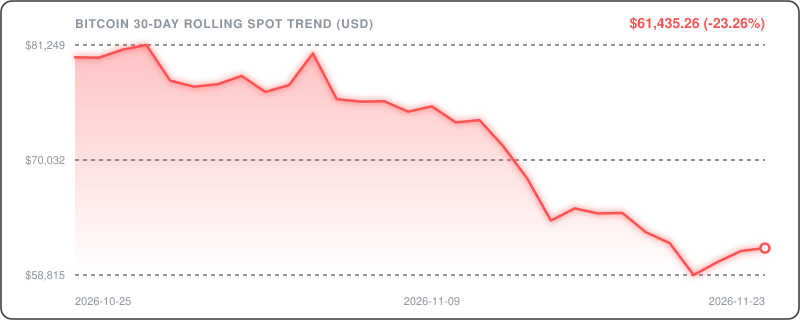

# 🪙 Bitcoin & Crypto Historical Tracker

<div align="center">

[](https://github.com)
[](https://github.com)
[](https://github.com/features/actions)
[](https://api.binance.com)
[](https://github.com)

</div>

---

### 📊 Executive Market Telemetry

Real-time Bitcoin ($BTC) market tracking telemetry, algorithmic historical benchmarks, and rolling price-action matrix. Fully automated and synced via GitHub Actions CI/CD pipeline with zero external database dependencies.

| Telemetry Metric | Spot Value (USD) | 24h Trend / Spread | Reference Context |
| :--- | :--- | :--- | :--- |
| **Current BTC Price** | **$60,460.74** | 🟢 `+0.13%` | Real-time Aggregate Spot |
| **24h Price Range** | `$60,295.31 — $61,526.89` | `Spread: $1,231.58` | Intraday Volatility Band |
| **24h Trading Volume** | `$153.34 M` | `2,536.26 BTC` | 24h Spot Pair Turnover |
| **Estimated Market Cap** | `$1.20 T` | `Rank #1` | Circulating Supply: ~19.85M BTC |

---

### 📈 30-Day Rolling Price Action & Volatility Trend

<div align="center">
  
</div>

---

### 📊 Multi-Timeframe Performance & ROI Matrix

Comparison of current spot valuation against standard macroeconomic and historical milestones.

| Timeframe Horizon | Benchmark Date | Historical Base Price | Net Change ($) | ROI Return (%) | Direction & Velocity |
| :--- | :---: | :---: | :---: | :---: | :---: |
| **24 Hours** | `2026-11-25` | $60,383.51 | `+$77.23` | 🟢 +0.13% | Intraday Shift |
| **7 Days** | `2026-11-19` | $61,913.23 | `-$1,452.49` | 🔴 -2.35% | Weekly Momentum |
| **30 Days (1M)** | `2026-10-27` | $80,799.51 | `-$20,338.77` | 🔴 -25.17% | Monthly Trajectory |
| **90 Days (Quarterly)** | `2026-08-28` | $77,839.19 | `-$17,378.45` | 🔴 -22.33% | Quarterly Baseline |
| **180 Days (Half-Year)** | `2026-05-30` | $73,770.69 | `-$13,309.95` | 🔴 -18.04% | Semi-Annual Cycle |
| **365 Days (1 Year)** | `2025-12-12` | $90,278.00 | `-$29,817.26` | 🔴 -33.03% | Macro Annual Delta |
| **All-Time High (ATH)** | `2025-01-20` | $108,900.00 | `-$48,439.26` | 🔴 `-44.48%` | Peak Drawdown |

---

### 🗓️ Rolling 7-Day Price Action Log

Detailed historical daily candlestick telemetry for the last 7 trading sessions.

| Date (UTC) | Open (USD) | High (USD) | Low (USD) | Close (USD) | 24h Change | Volume (BTC) |
| :---: | :---: | :---: | :---: | :---: | :---: | :---: |
| `2026-11-26` | $60,383.50 | $61,526.89 | $60,295.31 | $60,460.74 | 🟢 +0.13% | `2,536.26 BTC` |
| `2026-11-25` | $59,741.39 | $60,487.00 | $57,208.17 | $60,383.51 | 🟢 +1.07% | `16,694.51 BTC` |
| `2026-11-24` | $61,190.81 | $61,603.49 | $59,189.67 | $59,740.87 | 🔴 -2.37% | `13,455.73 BTC` |
| `2026-11-23` | $61,163.01 | $64,533.96 | $60,286.92 | $61,189.97 | 🟢 +0.04% | `16,914.31 BTC` |
| `2026-11-22` | $60,086.00 | $61,568.11 | $58,636.18 | $61,163.01 | 🟢 +1.79% | `8,857.87 BTC` |
| `2026-11-21` | $58,815.33 | $60,883.03 | $55,106.00 | $60,086.00 | 🟢 +2.16% | `17,117.92 BTC` |
| `2026-11-20` | $61,911.58 | $62,562.15 | $57,655.17 | $58,814.99 | 🔴 -5.00% | `23,600.20 BTC` |

---

### ⚙️ Automation & Pipeline Architecture

- **Automated Execution:** Synced daily at `00:00 UTC` via GitHub Actions (`.github/workflows/update.yml`).
- **Resilient Pipeline:** Cascading multi-exchange API architecture (Binance -> Coinbase -> Kraken -> CoinGecko).
- **Git-Native Telemetry:** Dynamic SVG vector graphics and Markdown dashboards saved directly into Git history.

```
[ GitHub Actions Cron: 00:00 UTC ]
               │
               ▼
   [ fetch_btc.py Executed ] ──► [ Query Multi-Exchange Feeds ]
               │
               ▼
   [ Generate assets/btc_trend.svg & README.md ]
               │
               ▼
   [ Auto Git Commit & Push (main) ]
```

---

<div align="center">

*Last Telemetry Sync: `2026-11-26 07:21:52 UTC` • Data Feed: `Coinbase Exchange API (BTC/USD)` • Status: `Operational (HTTP 200 OK)`*

</div>
