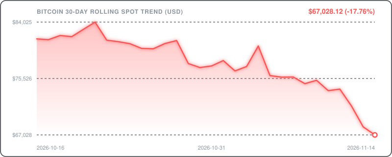

# 🪙 Bitcoin & Crypto Historical Tracker

<div align="center">

[](https://github.com)
[](https://github.com)
[](https://github.com/features/actions)
[](https://api.binance.com)
[](https://github.com)

</div>

---

### 📊 Executive Market Telemetry

Real-time Bitcoin ($BTC) market tracking telemetry, algorithmic historical benchmarks, and rolling price-action matrix. Fully automated and synced via GitHub Actions CI/CD pipeline with zero external database dependencies.

| Telemetry Metric | Spot Value (USD) | 24h Trend / Spread | Reference Context |
| :--- | :--- | :--- | :--- |
| **Current BTC Price** | **$73,547.41** | 🔴 `-0.51%` | Real-time Aggregate Spot |
| **24h Price Range** | `$73,421.05 — $74,123.71` | `Spread: $702.66` | Intraday Volatility Band |
| **24h Trading Volume** | `$82.43 M` | `1,120.74 BTC` | 24h Spot Pair Turnover |
| **Estimated Market Cap** | `$1.46 T` | `Rank #1` | Circulating Supply: ~19.85M BTC |

---

### 📈 30-Day Rolling Price Action & Volatility Trend

<div align="center">
  
</div>

---

### 📊 Multi-Timeframe Performance & ROI Matrix

Comparison of current spot valuation against standard macroeconomic and historical milestones.

| Timeframe Horizon | Benchmark Date | Historical Base Price | Net Change ($) | ROI Return (%) | Direction & Velocity |
| :--- | :---: | :---: | :---: | :---: | :---: |
| **24 Hours** | `2026-11-11` | $73,927.63 | `-$380.22` | 🔴 -0.51% | Intraday Shift |
| **7 Days** | `2026-11-05` | $75,969.06 | `-$2,421.65` | 🔴 -3.19% | Weekly Momentum |
| **30 Days (1M)** | `2026-10-13` | $83,101.99 | `-$9,554.58` | 🔴 -11.50% | Monthly Trajectory |
| **90 Days (Quarterly)** | `2026-08-14` | $62,975.19 | `+$10,572.22` | 🟢 +16.79% | Quarterly Baseline |
| **180 Days (Half-Year)** | `2026-05-16` | $78,105.45 | `-$4,558.04` | 🔴 -5.84% | Semi-Annual Cycle |
| **365 Days (1 Year)** | `2025-11-28` | $90,902.70 | `-$17,355.29` | 🔴 -19.09% | Macro Annual Delta |
| **All-Time High (ATH)** | `2025-01-20` | $108,900.00 | `-$35,352.59` | 🔴 `-32.46%` | Peak Drawdown |

---

### 🗓️ Rolling 7-Day Price Action Log

Detailed historical daily candlestick telemetry for the last 7 trading sessions.

| Date (UTC) | Open (USD) | High (USD) | Low (USD) | Close (USD) | 24h Change | Volume (BTC) |
| :---: | :---: | :---: | :---: | :---: | :---: | :---: |
| `2026-11-12` | $73,927.63 | $74,123.71 | $73,421.05 | $73,547.41 | 🔴 -0.51% | `1,120.74 BTC` |
| `2026-11-11` | $73,697.88 | $74,737.15 | $73,110.00 | $73,927.63 | 🟢 +0.31% | `8,133.46 BTC` |
| `2026-11-10` | $75,257.77 | $75,340.23 | $72,643.48 | $73,697.87 | 🔴 -2.07% | `10,577.16 BTC` |
| `2026-11-09` | $74,756.52 | $75,500.00 | $73,636.00 | $75,259.28 | 🟢 +0.67% | `10,186.64 BTC` |
| `2026-11-08` | $75,753.95 | $76,094.99 | $73,477.00 | $74,754.08 | 🔴 -1.32% | `3,709.69 BTC` |
| `2026-11-07` | $75,731.05 | $76,152.43 | $75,452.88 | $75,753.96 | 🟢 +0.03% | `2,438.27 BTC` |
| `2026-11-06` | $75,969.06 | $76,306.26 | $74,722.00 | $75,731.04 | 🔴 -0.31% | `8,332.69 BTC` |

---

### ⚙️ Automation & Pipeline Architecture

- **Automated Execution:** Synced daily at `00:00 UTC` via GitHub Actions (`.github/workflows/update.yml`).
- **Resilient Pipeline:** Cascading multi-exchange API architecture (Binance -> Coinbase -> Kraken -> CoinGecko).
- **Git-Native Telemetry:** Dynamic SVG vector graphics and Markdown dashboards saved directly into Git history.

```
[ GitHub Actions Cron: 00:00 UTC ]
               │
               ▼
   [ fetch_btc.py Executed ] ──► [ Query Multi-Exchange Feeds ]
               │
               ▼
   [ Generate assets/btc_trend.svg & README.md ]
               │
               ▼
   [ Auto Git Commit & Push (main) ]
```

---

<div align="center">

*Last Telemetry Sync: `2026-11-12 06:16:54 UTC` • Data Feed: `Coinbase Exchange API (BTC/USD)` • Status: `Operational (HTTP 200 OK)`*

</div>
