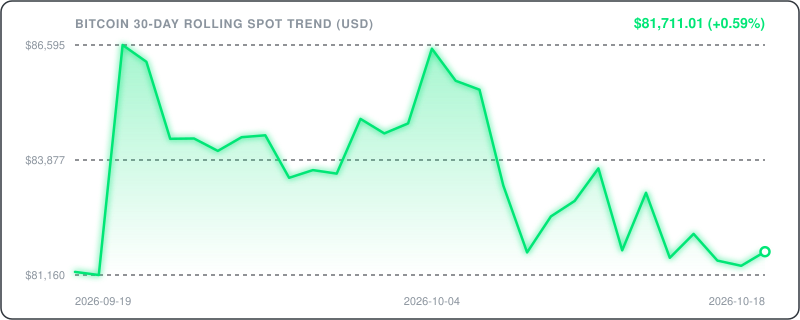

# 🪙 Bitcoin & Crypto Historical Tracker

<div align="center">

[](https://github.com)
[](https://github.com)
[](https://github.com/features/actions)
[](https://api.binance.com)
[](https://github.com)

</div>

---

### 📊 Executive Market Telemetry

Real-time Bitcoin ($BTC) market tracking telemetry, algorithmic historical benchmarks, and rolling price-action matrix. Fully automated and synced via GitHub Actions CI/CD pipeline with zero external database dependencies.

| Telemetry Metric | Spot Value (USD) | 24h Trend / Spread | Reference Context |
| :--- | :--- | :--- | :--- |
| **Current BTC Price** | **$82,658.31** | 🔴 `-0.34%` | Real-time Aggregate Spot |
| **24h Price Range** | `$82,629.12 — $83,143.76` | `Spread: $514.64` | Intraday Volatility Band |
| **24h Trading Volume** | `$35.83 M` | `433.52 BTC` | 24h Spot Pair Turnover |
| **Estimated Market Cap** | `$1.64 T` | `Rank #1` | Circulating Supply: ~19.85M BTC |

---

### 📈 30-Day Rolling Price Action & Volatility Trend

<div align="center">
  
</div>

---

### 📊 Multi-Timeframe Performance & ROI Matrix

Comparison of current spot valuation against standard macroeconomic and historical milestones.

| Timeframe Horizon | Benchmark Date | Historical Base Price | Net Change ($) | ROI Return (%) | Direction & Velocity |
| :--- | :---: | :---: | :---: | :---: | :---: |
| **24 Hours** | `2026-10-20` | $82,938.26 | `-$279.95` | 🔴 -0.34% | Intraday Shift |
| **7 Days** | `2026-10-14` | $81,566.29 | `+$1,092.02` | 🟢 +1.34% | Weekly Momentum |
| **30 Days (1M)** | `2026-09-21` | $86,594.94 | `-$3,936.63` | 🔴 -4.55% | Monthly Trajectory |
| **90 Days (Quarterly)** | `2026-07-23` | $65,051.23 | `+$17,607.08` | 🟢 +27.07% | Quarterly Baseline |
| **180 Days (Half-Year)** | `2026-04-24` | $77,461.80 | `+$5,196.51` | 🟢 +6.71% | Semi-Annual Cycle |
| **365 Days (1 Year)** | `2025-11-06` | $101,290.50 | `-$18,632.19` | 🔴 -18.39% | Macro Annual Delta |
| **All-Time High (ATH)** | `2025-01-20` | $108,900.00 | `-$26,241.69` | 🔴 `-24.10%` | Peak Drawdown |

---

### 🗓️ Rolling 7-Day Price Action Log

Detailed historical daily candlestick telemetry for the last 7 trading sessions.

| Date (UTC) | Open (USD) | High (USD) | Low (USD) | Close (USD) | 24h Change | Volume (BTC) |
| :---: | :---: | :---: | :---: | :---: | :---: | :---: |
| `2026-10-21` | $82,938.26 | $83,143.76 | $82,629.12 | $82,658.31 | 🔴 -0.34% | `433.52 BTC` |
| `2026-10-20` | $81,837.70 | $83,344.25 | $81,080.64 | $82,938.26 | 🟢 +1.34% | `5,237.79 BTC` |
| `2026-10-19` | $82,006.85 | $83,076.23 | $81,634.43 | $81,837.69 | 🔴 -0.21% | `4,758.02 BTC` |
| `2026-10-18` | $81,387.16 | $82,183.56 | $80,564.57 | $82,006.85 | 🟢 +0.76% | `2,937.80 BTC` |
| `2026-10-17` | $81,500.04 | $81,655.47 | $80,700.00 | $81,378.21 | 🔴 -0.15% | `1,890.36 BTC` |
| `2026-10-16` | $82,131.46 | $82,831.01 | $80,693.69 | $81,500.04 | 🔴 -0.77% | `5,082.37 BTC` |
| `2026-10-15` | $81,566.28 | $82,555.08 | $79,676.02 | $82,131.46 | 🟢 +0.69% | `7,047.11 BTC` |

---

### ⚙️ Automation & Pipeline Architecture

- **Automated Execution:** Synced daily at `00:00 UTC` via GitHub Actions (`.github/workflows/update.yml`).
- **Resilient Pipeline:** Cascading multi-exchange API architecture (Binance -> Coinbase -> Kraken -> CoinGecko).
- **Git-Native Telemetry:** Dynamic SVG vector graphics and Markdown dashboards saved directly into Git history.

```
[ GitHub Actions Cron: 00:00 UTC ]
               │
               ▼
   [ fetch_btc.py Executed ] ──► [ Query Multi-Exchange Feeds ]
               │
               ▼
   [ Generate assets/btc_trend.svg & README.md ]
               │
               ▼
   [ Auto Git Commit & Push (main) ]
```

---

<div align="center">

*Last Telemetry Sync: `2026-10-21 03:46:45 UTC` • Data Feed: `Coinbase Exchange API (BTC/USD)` • Status: `Operational (HTTP 200 OK)`*

</div>
